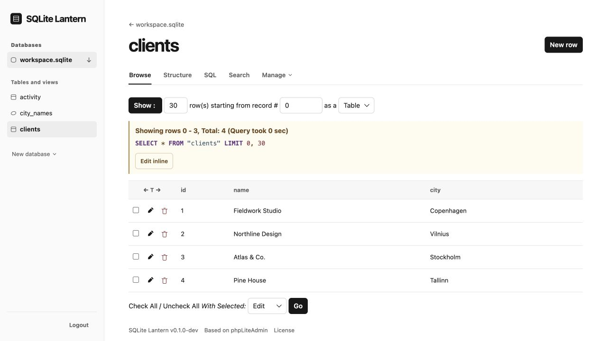

# SQLite Lantern

SQLite Lantern is an open-source, self-hosted SQLite database browser and editor written in PHP. Browse tables, edit records, and run SQL against your `.sqlite` and `.db` files from the web. The app builds into a single PHP file.

## What you can do

- Browse, sort, and search rows in SQLite tables and views.
- Add, edit, and delete records.
- Create tables and views, edit columns, and manage indexes and triggers.
- Switch between database files, import and export SQL or CSV, and download a copy of a database file.

## Credits and license

SQLite Lantern is a fork of [phpLiteAdmin](https://github.com/phpLiteAdmin/pla/tree/3fa9fedad19dc407a1786f97ba2b18a3c7b803bc). See the [original credits and copyright notices](docs/header.txt).

Licensed under the [GNU GPL v3 or later](LICENSE).
